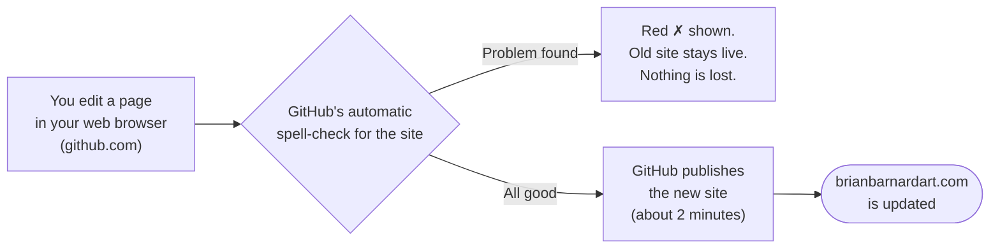
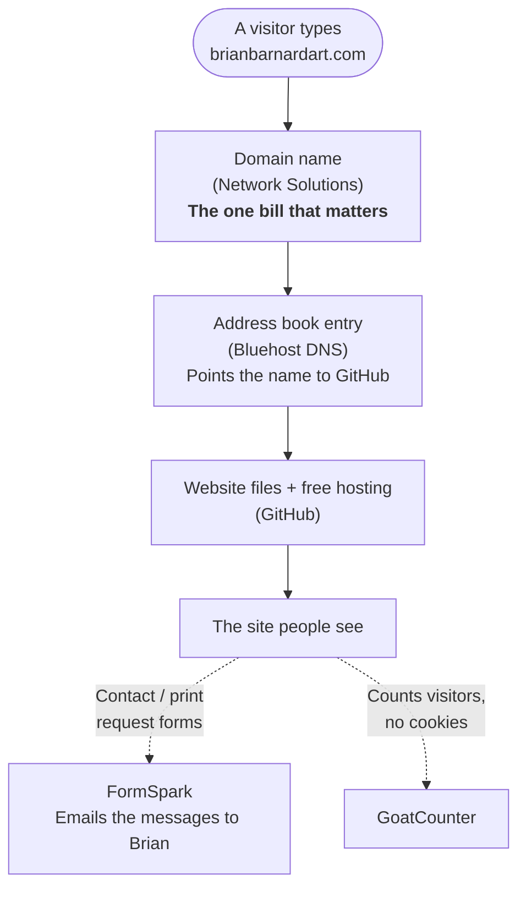
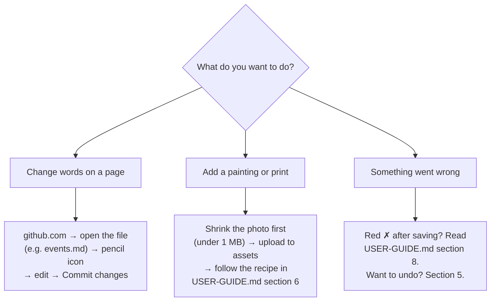

# Start here: brianbarnardart.com in plain English

This is a one-page overview for anyone taking over the website: a family
member, a friend, an accountant, a hired helper. No programming is needed.
The longer manual is [USER-GUIDE.md](USER-GUIDE.md).

---

## What this website is

Most small-business sites (Wix, WordPress) charge a monthly fee and run on a
server. This one is different on purpose:

- It is a **folder of text files and pictures** kept on GitHub (a free
  service for storing files).
- GitHub **turns that folder into a website** automatically, for free.
- The only yearly cost is the **domain name** (the `brianbarnardart.com`
  address), about the price of a lunch.

So if nobody touches it, it keeps running. There is nothing to patch,
renew monthly, or keep "up to date."

---

## The big picture

A printable one-page version of the diagrams below is in
[docs/site-overview.svg](docs/site-overview.svg) (open it in any web browser).

You cannot break the live site by editing. A mistake just means your change
doesn't appear until it's fixed.

---

## Who and what to keep paid up and logged in

| Service | In one sentence | Cost | If it lapses |
|---|---|---|---|
| **Network Solutions** | Owns the `brianbarnardart.com` name | Yearly. Expires **Feb 2, 2027** | **Site goes offline** and someone else could buy the name |
| **GitHub** | Holds every page and picture; hosts the site | Free | Site stays up, but nobody can edit it |
| **Bluehost (DNS)** | The "address book" pointing the name at GitHub | Free/included | Site goes offline if entries are deleted. Leave alone |
| **FormSpark** | Delivers form messages to email | Free tier | Site fine, but messages stop arriving |
| **GoatCounter** | Visitor counts | Free | Counts stop. Nothing else changes |

Exact logins, form IDs and blanks to fill in are in
[USER-GUIDE.md, section 2](USER-GUIDE.md#2-accounts-and-who-holds-the-keys).

---

## Your short to-do list

**Do this once (protects against "only Brian knows")**
- [ ] Put every login above in a password manager (ideally a shared one),
      and save GitHub's two-factor **recovery codes** somewhere safe.
- [ ] With Brian at the keyboard, raise a trusted person's GitHub role to
      **Admin** (Settings → Collaborators). Today AE1020 can edit pages but
      not change settings.
- [ ] Confirm with Brian where the domain is registered (the docs say
      Network Solutions, with Bluehost as the address book) and who else could
      log in there.
- [ ] Name a GitHub "successor" (Account settings → Successor settings).
- [ ] Make sure the domain's **auto-renew is ON** and the card is current.
- [ ] Fill in the ✏️ blanks in USER-GUIDE.md section 2.

**Do this once a year**
- [ ] Check the domain renewal and card.
- [ ] Log into each service to prove the password still works.
- [ ] Send a test message through the Contact page and confirm it arrives.

---

## Common jobs: where to click

Which file holds which page is listed in
[USER-GUIDE.md, section 3](USER-GUIDE.md#3-how-the-site-works-in-one-picture).

---

## Small glossary

| Word | Meaning here |
|---|---|
| **Repository ("repo")** | The project folder on GitHub holding all the site's files |
| **Commit** | Pressing Save, with a short note about what you changed |
| **`main`** | The "live" copy of the site. Saving to it publishes it |
| **Markdown (`.md`)** | Plain text with light formatting marks (like `**bold**`) |
| **Build / deploy** | GitHub assembling the files into the website and publishing it |
| **DNS** | The internet's address book: it says where the name points |
| **Domain / registrar** | The address (`brianbarnardart.com`) / the company you rent it from |

---

## If you're stuck

Paste the file or the red-✗ error message into an AI assistant (ChatGPT,
Copilot, Claude) and say "I'm not a programmer, please explain." The project
includes instructions ([AGENTS.md](AGENTS.md)) that tell AI helpers how to
work safely here. Details: [USER-GUIDE.md, section 12](USER-GUIDE.md#12-getting-help-including-from-ai-assistants).
